# SOC SSH Brute-Force Detection Lab with Elastic Stack

## Overview

This project demonstrates an end-to-end SOC workflow for detecting, investigating, and responding to repeated SSH authentication failures in a controlled VirtualBox home lab.

A Kali Linux virtual machine is used to generate authorized failed SSH authentication attempts against an Ubuntu Server. Filebeat collects the Ubuntu authentication logs and sends them to Logstash on the ELK Server. Logstash processes the events, Elasticsearch stores and indexes them, and Kibana is used for analysis, visualization, detection, and incident investigation.

The project covers:

- Linux authentication-log collection
- SSH failed-login analysis
- Centralized log ingestion with Filebeat and Logstash
- Elasticsearch indexing
- Kibana investigation and dashboarding
- Threshold-based SSH brute-force detection
- Source-IP and target-user identification
- SOC alert triage
- Incident timeline reconstruction
- Containment using UFW
- Containment and recovery verification
- Incident documentation
- MITRE ATT&CK mapping

> [!IMPORTANT]
> All activity in this repository is intended only for systems owned by the lab operator and operated inside an isolated VirtualBox Host-Only network.

---

## Lab Architecture

| Component | Role | IP Address |
|---|---|---:|
| Ubuntu ELK Server | Elasticsearch, Logstash, Kibana | `192.168.56.121` |
| Kali Linux | Authorized attacker and analyst workstation | `192.168.56.122` |
| Ubuntu Server | Monitored endpoint with SSH and Filebeat | `192.168.56.123` |
| VirtualBox Host-Only Network | Isolated lab network | `192.168.56.0/24` |

### Data and Investigation Flow

```text
Kali Linux
192.168.56.122
Authorized failed SSH attempts
        |
        | SSH / TCP 22
        v
Ubuntu Monitored Server
192.168.56.123
OpenSSH + authentication logs + Filebeat
        |
        | Beats / TCP 5044
        v
Ubuntu ELK Server
192.168.56.121
Logstash -> Elasticsearch -> Kibana
        |
        v
Detection -> SOC Triage -> Investigation
        |
        v
Containment -> Verification -> Recovery
```

For the detailed topology, see [`documentation/01-network-topology.md`](documentation/01-network-topology.md).

---

## Tools and Technologies

- Oracle VirtualBox
- Ubuntu Server
- Kali Linux
- OpenSSH
- Filebeat
- Logstash
- Elasticsearch
- Kibana
- Linux authentication logs
- UFW
- Bash and standard Linux utilities
- MITRE ATT&CK

---

## Repository Structure

```text
soc-ssh-bruteforce-detection-elk-lab/
├── README.md
├── detection/
│   ├── kibana-query.md
│   └── ssh-bruteforce-rule.md
├── documentation/
│   ├── 01-network-topology.md
│   ├── 02-log-onboarding.md
│   ├── 03-attack-simulation.md
│   ├── 04-investigation-workflow.md
│   └── 05-containment-recovery.md
├── evidence/
│   └── README.md
├── filebeat/
│   └── filebeat.yml.example
├── incident-report/
│   └── ssh-bruteforce-incident-report.md
├── logstash/
│   └── linux-auth.conf.example
└── screenshots/
    └── README.md
```

---

## SOC Investigation Workflow

```text
Validate normal SSH access
        |
Generate controlled failed SSH logins
        |
Collect authentication logs with Filebeat
        |
Parse and index events in Elasticsearch
        |
Investigate events in Kibana
        |
Trigger threshold-based detection
        |
Identify source IP, user, time, and outcome
        |
Contain the source using UFW
        |
Verify blocked access and continued log flow
        |
Remove the temporary block after validation
        |
Document evidence, findings, and lessons learned
```

---

## Implementation Guide

### 1. Validate Connectivity

From Kali Linux:

```bash
ping -c 4 192.168.56.123
nc -zv 192.168.56.123 22
```

From the Ubuntu monitored server:

```bash
ping -c 4 192.168.56.121
nc -zv 192.168.56.121 5044
```

### 2. Confirm SSH and Filebeat

On the monitored Ubuntu Server:

```bash
sudo systemctl is-active ssh
sudo systemctl is-active filebeat
sudo filebeat test config -e
sudo filebeat test output -e
```

### 3. Confirm the Elastic Stack

On the ELK Server:

```bash
systemctl is-active elasticsearch logstash kibana
sudo ss -lntp | grep -E ':5044|:5601|:9200'
```

### 4. Establish a Normal Baseline

From Kali Linux, perform one authorized successful SSH login:

```bash
ssh <lab-user>@192.168.56.123
```

On the monitored server, verify the accepted event:

```bash
sudo journalctl -u ssh --since "10 minutes ago"
```

### 5. Generate Controlled Failed Authentication Events

Follow [`documentation/03-attack-simulation.md`](documentation/03-attack-simulation.md). Use only the isolated lab system.

### 6. Investigate in Kibana

Open Kibana and use the queries in [`detection/kibana-query.md`](detection/kibana-query.md). Confirm:

- Source IP: `192.168.56.122`
- Destination host: Ubuntu monitored server
- SSH service or process
- Failed authentication outcome
- Targeted username
- Event count and time range

### 7. Create the Detection Rule

Use the implementation guidance in [`detection/ssh-bruteforce-rule.md`](detection/ssh-bruteforce-rule.md).

### 8. Contain and Verify

Follow [`documentation/05-containment-recovery.md`](documentation/05-containment-recovery.md).

### 9. Complete the Incident Report

Record the validated results in [`incident-report/ssh-bruteforce-incident-report.md`](incident-report/ssh-bruteforce-incident-report.md).

---

## Detection Logic

### Objective

Detect repeated failed SSH authentication attempts from the same source IP against the monitored Ubuntu Server.

### Recommended Lab Threshold

- Event: failed SSH authentication
- Group by: `source.ip`
- Threshold: 5 or more events
- Time window: 1 minute
- Severity: Medium
- Risk score: 47

> Adjust field names after checking the actual Filebeat data in Kibana Discover. Field availability can vary depending on the ingest pipeline and Filebeat integration.

### Generic KQL

```text
host.ip:"192.168.56.123" and event.category:authentication and event.outcome:failure
```

Fallback search:

```text
message:"Failed password" and source.ip:"192.168.56.122"
```

---

## MITRE ATT&CK Mapping

| Tactic | Technique | Relevance |
|---|---|---|
| Credential Access | T1110 - Brute Force | Repeated attempts to authenticate to SSH accounts |
| Credential Access | T1110.001 - Password Guessing | Repeated password guesses against one or more usernames |
| Initial Access / Persistence | T1078 - Valid Accounts | Review successful authentication after failures to identify possible account compromise |

---

## Project Evidence

The following evidence documents the complete SOC workflow, from lab
validation and centralized log collection to detection, notification,
containment, and recovery.

### 1. VirtualBox Lab Environment

The lab consists of an ELK Server, a Kali Linux machine used for the
authorized SSH authentication simulation, and an Ubuntu Server monitored
by Filebeat.

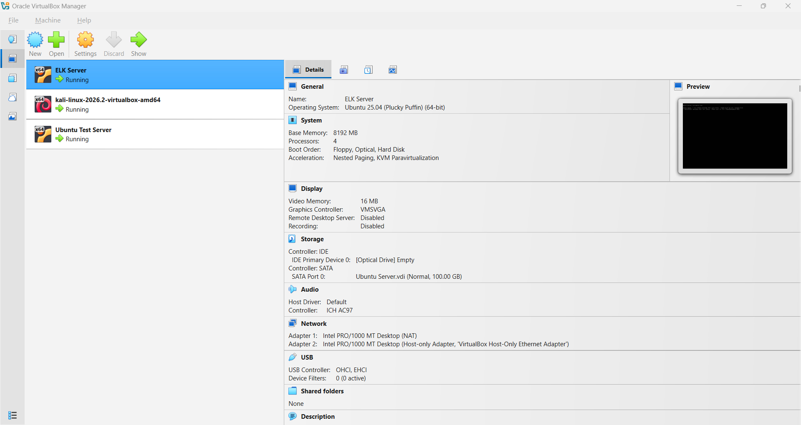

---

### 2. ELK Stack Services

Elasticsearch, Logstash, and Kibana were validated on the ELK Server.
Logstash listens for incoming Filebeat events on TCP port 5044.

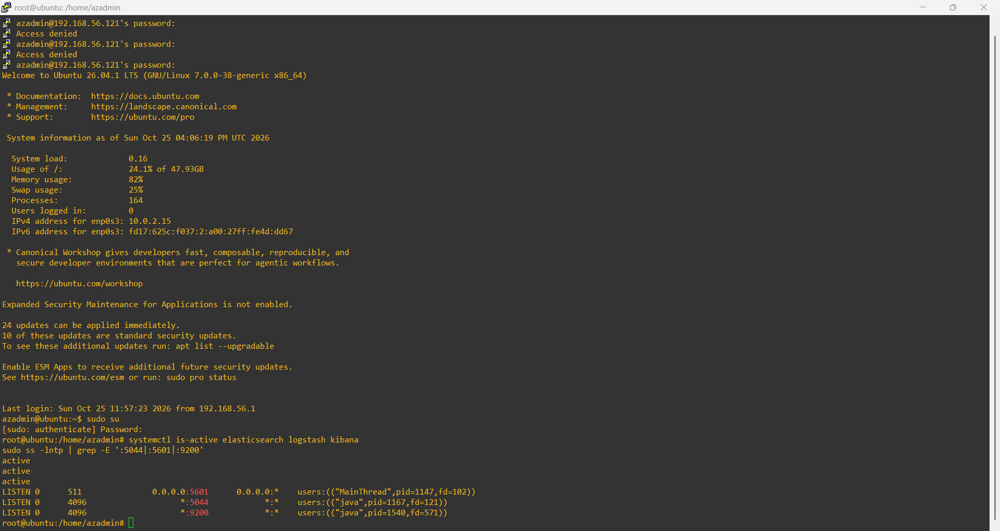

---

### 3. Filebeat Validation

Filebeat was validated on the monitored Ubuntu Server. The configuration
test and Logstash output connection completed successfully.

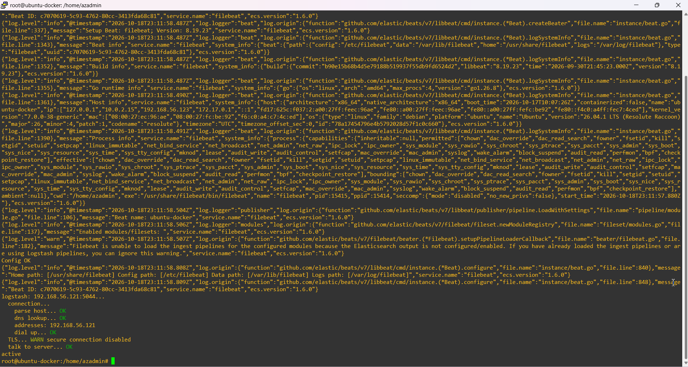

---

### 4. Successful SSH Authentication Baseline

A successful SSH authentication was performed before generating suspicious
activity. This established a known-good baseline for comparison during the
investigation.

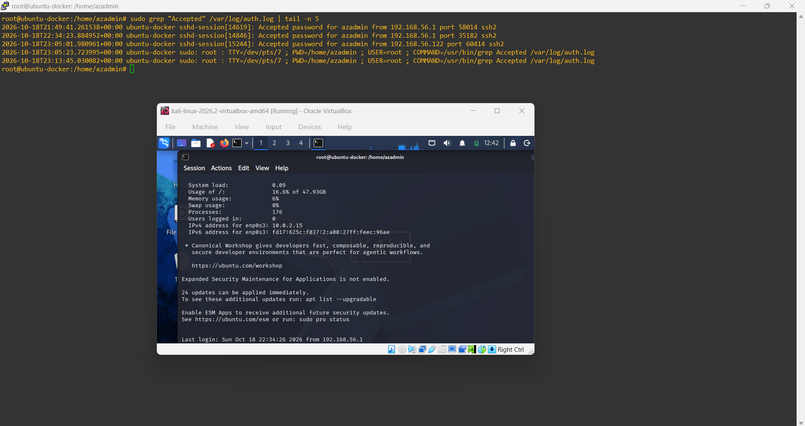

---

### 5. Failed SSH Authentication Events

Repeated failed SSH authentication attempts were generated from the
authorized Kali Linux machine against the monitored Ubuntu Server inside
the isolated VirtualBox network.

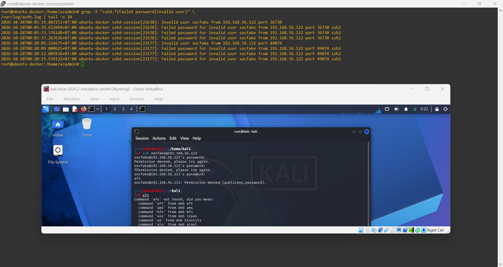

---

### 6. Kibana Discover Investigation

The failed SSH authentication events were analyzed in Kibana Discover.
The investigation confirmed the event timestamps, monitored host, source
address, targeted account, and authentication outcome.

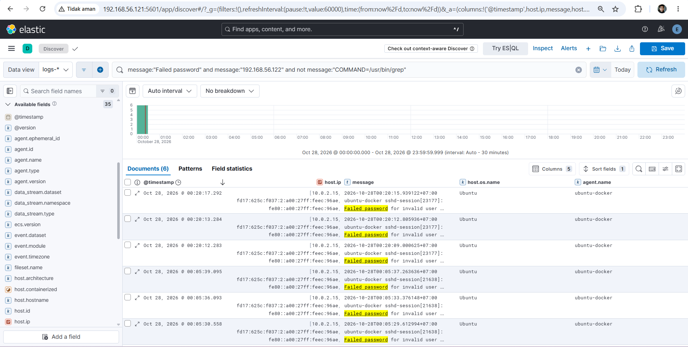

---

### 7. SSH Brute-Force Detection Rule

A detection rule was configured to identify multiple failed SSH
authentication attempts within the defined detection window.

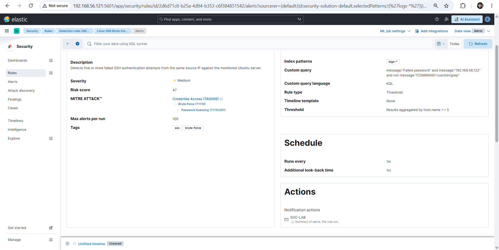

---

### 8. Security Alert Generated

The detection rule successfully generated a security alert after the
configured conditions were met.

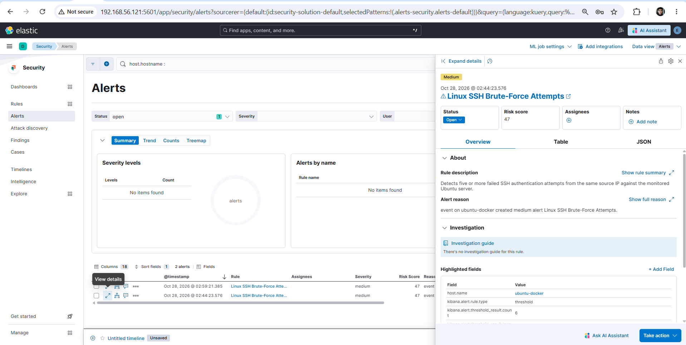

---

### 9. Email Alert Notification

An email connector delivered an automated notification containing the
rule information, monitored agent, source address, alert level, and
detection message.

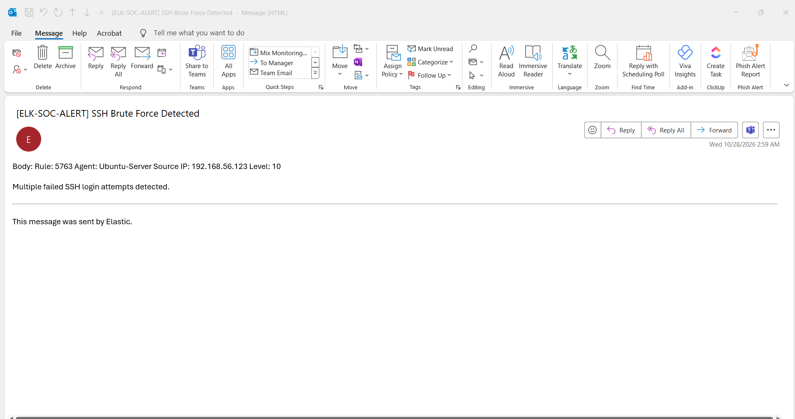

---

### 10. UFW Containment

A temporary UFW rule was implemented on the monitored Ubuntu Server to
block SSH connections from the identified source address while preserving
the SSH service for other permitted sources.

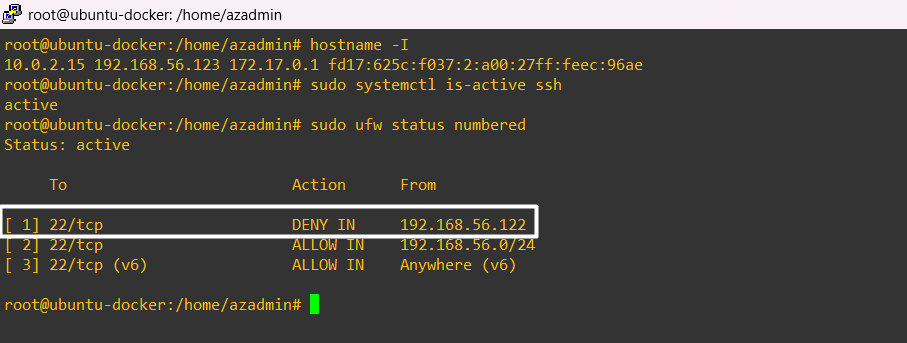

---

### 11. Containment Verification

SSH connectivity from the contained source was tested after the UFW rule
was applied. The connection was blocked while the SSH service remained
active on the monitored server.

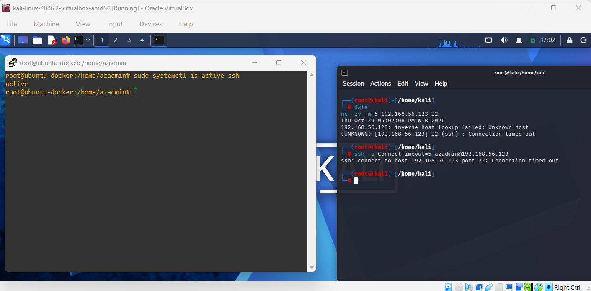

---

### 12. Recovery Verification

The temporary UFW deny rule was removed after validation. SSH connectivity
was successfully restored, confirming that the monitored server returned
to its normal operating state.

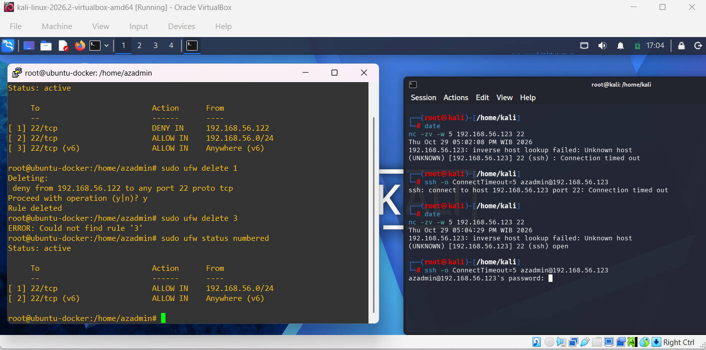

See [`screenshots/README.md`](screenshots/README.md) for filenames and guidance.

---

## Expected Outcome

At the end of this lab, the analyst should be able to:

- Explain the end-to-end Linux authentication log pipeline
- Identify repeated SSH failures in Kibana
- Build and validate a threshold-based detection rule
- Perform basic SOC alert triage
- Reconstruct a simple incident timeline
- Contain a suspicious source with a host firewall
- Validate containment and recovery
- Document evidence and investigation findings

---

## Project Status

## Project Status

- [x] VirtualBox SOC lab environment configured
- [x] Elasticsearch, Logstash, and Kibana services validated
- [x] System clocks synchronized using NTP
- [x] Logstash Beats input configured on TCP port 5044
- [x] Filebeat configuration and output connectivity validated
- [x] Linux authentication logs successfully collected and indexed
- [x] Successful SSH authentication baseline recorded
- [x] Controlled failed SSH authentication activity generated
- [x] Authentication events investigated in Kibana Discover
- [x] SSH brute-force detection rule created and enabled
- [x] Security alert successfully generated
- [x] Elastic email connector configured
- [x] Automated email alert successfully received
- [x] SOC alert triage and investigation completed
- [x] Temporary UFW source-IP containment applied
- [x] SSH containment successfully verified
- [x] Temporary firewall rule removed
- [x] SSH connectivity successfully restored
- [x] Incident report and project evidence completed
- [x] Sensitive information reviewed and sanitized
- [x] Project completed
---

## Disclaimer

This project is for defensive security education in an isolated environment. Do not perform authentication testing, scanning, or access attempts against systems without explicit authorization.
